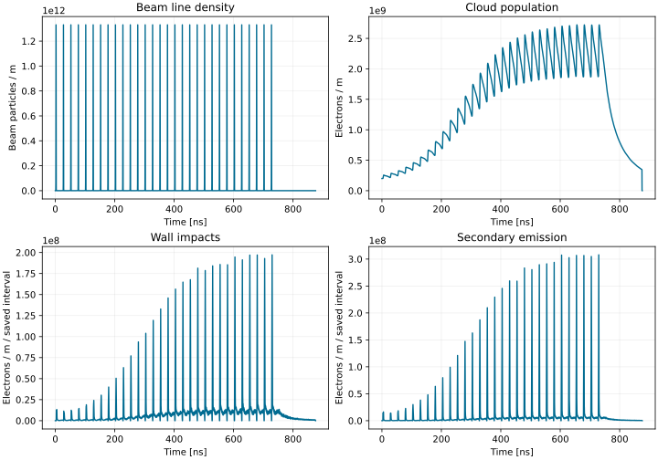
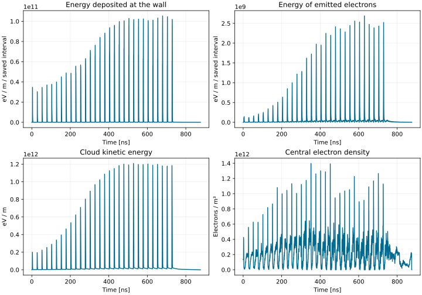
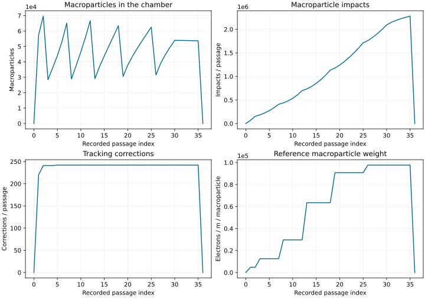
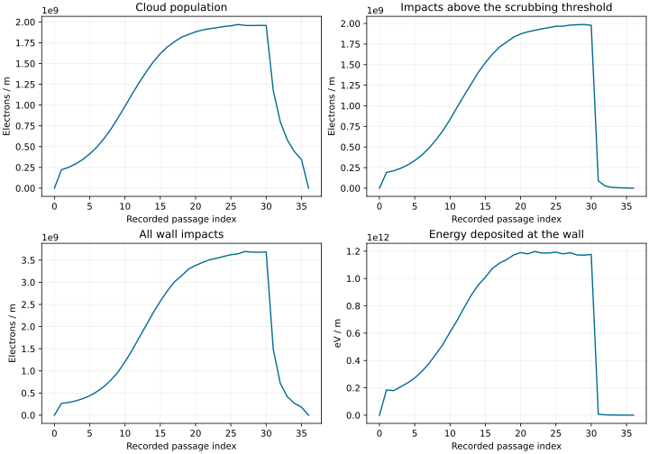
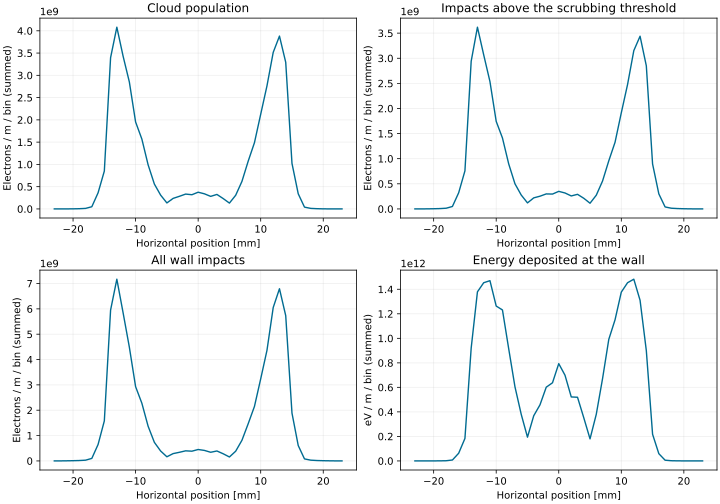

# Plotting buildup results

These figures show the beam profile, electron cloud buildup, and wall impacts
in an LHC dipole simulation. The macroparticle diagnostics and horizontal
distributions provide a closer look at the simulation.

## Beam and electron population



`lam_t_array` shows the beam line density and `Nel_timep` the electron
population per metre. `Nel_imp_time` and `Nel_emit_time` count impacts and
emissions accumulated over each saved interval, also per metre. Divide by
the saved interval duration to express these counts as rates.

## Energy and central density



`En_imp_eV_time` and `En_emit_eV_time` give the weighted energy of impacting
and emitted electrons during each saved interval. `En_kin_eV_time` is the
energy of the cloud at the saved time. These energies are normalized per metre
along the beam. `cen_density` measures the volume density near the chamber
centre, within the radius set by `r_center`.

## Macroparticle diagnostics



`N_mp_pass` counts simulation macroparticles, while `N_mp_ref_pass` records
their reference weight. `N_mp_impact_pass` and `N_mp_corrected_pass` track
impacts and tracking corrections during each passage.

## Histograms by passage and position

The horizontal histograms have shape `(number of passages, number of bins)`.
Rows correspond to `t_hist`; columns correspond to `xg_hist`.

```python
from PyECLOUD.myloadmat_to_obj import myloadmat_to_obj

data = myloadmat_to_obj("Pyecltest.mat")
electrons_per_passage = data.nel_hist.sum(axis=1)
population_sum_by_position = data.nel_hist.sum(axis=0)
```

Summing over bins (`axis=1`) gives one value per recorded passage:



Summing over passages (`axis=0`) gives the accumulated horizontal distribution:



For `nel_hist`, this sum combines population snapshots: the same electron can
contribute at several passages. It is not a count of distinct electrons.
For the impact histograms, it combines impacts recorded across the passages.
`nel_impact_hist_scrub` selects impacts above `scrub_en_th`.

The plotted values are per bin. Divide by the bin width to obtain a density
per unit horizontal position, or by the number of records to average snapshots.

## Reproduce these plots

The figures use the saved LHC dipole reference data from the original manual:

```text
testing/tests_buildup/LHC_ArcDipReal_450GeV_sey1.70_2.5e11ppb_bl_1.00ns/Pyecltest_angle3D_ref.mat
```

Download {download}`plot_buildup_outputs.py <../_static/plot_buildup_outputs.py>`
and pass this file's path to regenerate the figures. To plot your own output,
run it beside `Pyecltest.mat`:

```bash
python plot_buildup_outputs.py Pyecltest.mat
```

The script writes five SVG figures to `buildup-plots/` using the fields
shown on this page. The [output reference](../reference/outputs.md) describes
these fields and how to load them with `myloadmat_to_obj`.
Results from a new run can differ with the software version, input settings,
and random particle sampling.

Adapted from the original manual's plotting examples by E. Belli, L. Mether,
and A. Romano, preserved in `docs/legacy_tex/example/000_plot_main_output.py`.
